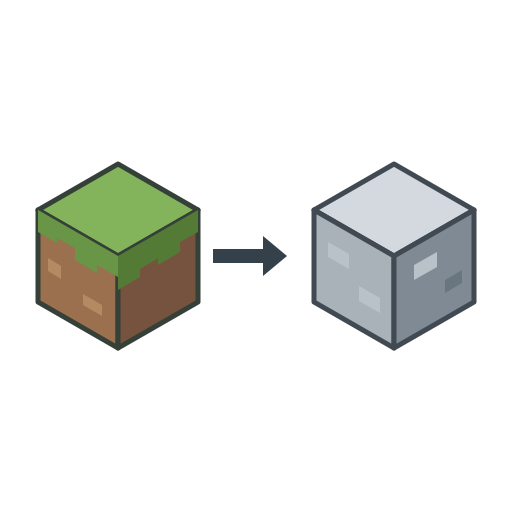
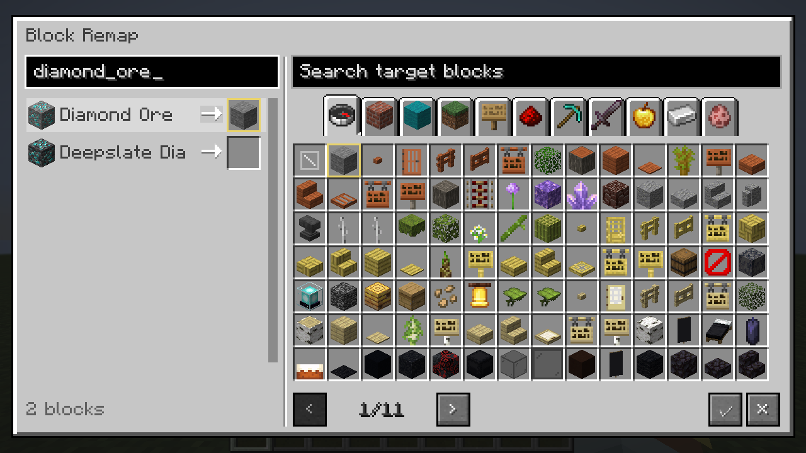

# Block Remap / 方块置换



## English

AI was used extensively during the development of this mod. Issues may still occur with different mod combinations and environments. If you do not trust AI-assisted projects, please think carefully before downloading and using it.

### Overview

Replace selected blocks during world generation or across the world. Disable structure generation by registry ID.

### Usage

Press **F9** in a world, or run `/blockgenban`. Select a source block on the left and a target block on the right. Click Confirm, then reopen the world to apply the replacements.

### Configuration

File: `config/blockgen_ban.json`

- `replacementMode`: choose generation-only (`generation_only`, default) or global replacement (`global`).
- `rules`: set block replacement rules.
- `disabledStructures`: disable specified structures.
- `disabledFeatures`: disable specified generated content, such as ores and trees.

Reopen the world or restart the server after changing block rules.

**Back up your world before using global mode. Changes to existing chunks are permanent, and replaced containers lose their contents.**

### Editor interface



### Installation and builds

| Minecraft | Loader tested | Java | Extra install |
| --- | --- | --- | --- |
| 1.20.1 | Forge 47.4.20 | 17 | None |
| 1.20.1 | Fabric Loader 0.16.14 | 17 | Fabric API 0.92.12+1.20.1 |
| 1.21.1 | NeoForge 21.1.265 | 21 | None |

Install the matching JAR in `mods`. For singleplayer, install it on the client. For multiplayer, install it on the server and on clients that need the editor. A server can also apply rules without clients installing the editor. Installed clients and servers should use the same mod version.

Build one platform with its Gradle Wrapper, for example:

```sh
cd platforms/fabric-1.20.1
./gradlew build
```

On Windows use `gradlew.bat`, or run `./build.ps1 -Platform all` from the repository root. Build outputs are in each platform's `build/libs`; the Windows helper copies installation JARs to `dist/1.0.0`. Tests and repeatable game fixtures are described in [tests/README.md](tests/README.md).

Author: **Rotten-flower**. Code: [MIT](LICENSE). Project artwork: [separate terms](LICENSE-ASSETS.md). [Third-party notices](THIRD_PARTY.md).

If you encounter any issues, please leave a comment or join our QQ group. Include your Minecraft version, mod version, mod loader, and logs whenever possible to help us investigate. Suggestions are also welcome! Your feedback will help guide improvements in future updates.

QQ group: 1095622706 · Support the author: [Afdian](https://afdian.com/a/lbcm233)

## 中文

在该模组开发过程中广泛使用了人工智能。不同的模组组合和环境仍可能出现问题。如果你不相信AI辅助项目，下载使用前请三思。

### 简介

在世界生成时替换指定方块，也可选择全局替换。通过注册名可以禁止指定结构生成。

### 使用说明

在世界中按 **F9**，或输入 `/blockgenban`。选择左侧来源方块，再选择右侧目标方块，点击确定后重新进入世界即可替换方块。

### 配置

配置文件：`config/blockgen_ban.json`

- `replacementMode`：选择仅世界生成（generation_only，默认）或全局替换（global）。

- `rules`：设置方块替换规则。

- `disabledStructures`：禁止指定结构生成。

- `disabledFeatures`：禁止指定矿石、树木等内容生成。

修改方块规则后，重新进入世界或重启服务器生效。

全局替换会永久修改旧区块，被替换容器中的物品不会保留，使用前请备份存档。

### 安装

Minecraft 1.20.1：Forge、Fabric。Minecraft 1.21.1：NeoForge。Fabric 版需要 Fabric API，具体已验证版本见上表。

单人游戏安装在客户端；多人游戏安装在服务器，需要编辑界面的客户端也安装。

### 开发

各端使用自己的 Gradle Wrapper 构建，Windows 根目录可运行 `./build.ps1 -Platform all`。安装包位于各端 `build/libs`，Windows 脚本汇总至 `dist/1.0.0`。游戏验证入口见 [tests/README.md](tests/README.md)。

作者：**Rotten-flower**。代码采用 [MIT](LICENSE)，项目美术按[单独条款](LICENSE-ASSETS.md)使用，[第三方说明](THIRD_PARTY.md)另列。

遇到问题可在评论区或 QQ 群反馈，并尽量提供 Minecraft 版本、模组版本、加载器和日志，方便排查。 欢迎提出改进建议，反馈将用于后续更新。

QQ 交流群：1095622706 · 支持作者：[爱发电](https://afdian.com/a/lbcm233)
